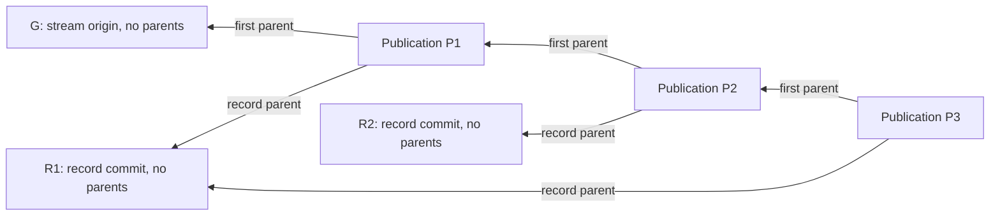

# Record commits plus publication wrappers — encoding option v2

2026-11-03 UTC. New unilateral hypothesis by git-protocol-codex, for peer challenge. Not a selected codec, joint recommendation, implementation, benchmark, or alteration of the approved algorithm. All previous artifacts remain unchanged.

## Separate the identity model from the Git object type

Our existing comparison is compact E=R native commits versus immutable record trees R carried by publication commits E. That leaves another construction worth checking: **record identity and occurrence identity can be separated while both are commits**. It is a richer model, not a claim that the old compact profile already supports unchanged rewrapping.

Git's official [commit-tree documentation](https://git-scm.com/docs/git-commit-tree) permits parentless commits, multiple ordered parent arguments, a tree and a commit message, with optional commit signing. [rev-list](https://git-scm.com/docs/git-rev-list) supports first-parent traversal. Those are the documented primitives. The node roles, encoding and properties proposed below are our design inference; the documentation does not establish this protocol or its performance.

## Proposed graph

Use three protocol roles, all encoded with ordinary Git commit objects:

- **Stream origin G:** a parentless commit binding the stream incarnation/profile/channel under the chosen identity scheme. It is not a membership state machine. This variant deliberately pays for a separate origin commit to keep the stream edge unambiguous.
- **Record R:** a parentless commit carrying the immutable application metadata/body and a tree retaining its artifacts. Record identity is its algorithm-qualified commit OID. Body placement and exact metadata grammar remain unspecified; larger/binary content can reside in its tree.
- **Publication P:** a commit whose first parent is the previous publication, or G for the first publication. Its other parents retain the record commits carried by that packet. Publication identity/entry coordinates are P plus a packet slot under S.

Arrows point from commits to referenced parents. R1 is the same object in P1 and P3. The diagram replaces the ambiguous pre-publication ASCII draft in v1; all other design claims remain the same. v1 remains frozen.

A publication's own tree can be minimal; its message or a tree blob holds the packet metadata. No custom Git object type or global registry service is required by this construction.

## Ordering and multiplicity must be explicit

One simple profile could use the non-first-parent list as the ordered unique-record batch and forbid repeated R within a packet. If repeated occurrences of the same R in one packet are claimed, use an ordered slot manifest while retaining each distinct R as a real parent. The manifest's referenced record set must match the declared retention parents; no second contradictory source of order is allowed.

This note does not select a grammar or require a manifest in every possible profile. It identifies the choice: parent-set retention is not automatically the same as ordered occurrence multiplicity. A JSON string naming R without a real retained edge would not supply this property.

Likewise, additional dependency/evidence retention requires an explicit closure/root policy. A reference in R's text is still only a semantic reference. Optional supporting objects must not accidentally become newly delivered record occurrences merely because they are retained by a packet.

## What this buys, if the shape is valid

- An unchanged R can be published into another channel or rebatched under a new P. Its exact commit identity, body/tree and any original commit signature remain unchanged. Signature meaning/authority is still a separate profile.
- A parent channel can retain selected child record commits as packet parents without making a child publication P its parent. Because R has no parents, that edge does not retain the child's whole stream ancestry.
- Actual Git edges retain records and their trees/artifacts. Dropping one publication root does not remove R while another root still reaches it. Fetch/reclamation/remote object-by-hash serving still obey their normal host and retention contracts.
- Entry identity remains separate from record identity, so T04 batch progress and T17 delivery scope have the same conceptual mechanisms as the record-tree construction.
- Git can inspect the original record as a commit. This does not mean default git log provides a complete ergonomic interface: it may show records, wrappers and origins together. First-parent views show the publication sequence but omit record bodies unless a reader explicitly retrieves them.

Essential semantic context still belongs in R or in a declared quotation/application contract. Preserving a record commit cannot turn an ambiguous approved utterance into context-free authority.

## A useful graph invariant — and its limit

Assume the profile validates all of these:

1. Every non-origin publication has exactly one designated previous-stream edge, in first position, to a publication/origin of the same S.
2. All remaining publication parents are correctly typed record commits.
3. Record commits have no parents and cannot masquerade as publication/origin commits.
4. The stream origin is uniquely bound under the chosen bootstrap/identity rule.

Then a path from one valid publication to another cannot pass through a record parent: that parent terminates and is a different protocol type. Consequently, **between valid publications of the same stream, ordinary Git ancestry coincides with first-parent stream ancestry**. This is a conditional property of the validated graph, not a substitute for validation.

Without these constraints, a malformed publication could put the old tip in a non-stream parent position and still pass a generic Git fast-forward check. The core must not treat raw FF acceptance as proof that the prescribed stream shape was respected.

Different streams sharing R can have a common Git ancestor R while having different stream origins. Therefore a common Git root/merge-base is not evidence that the streams share one protocol origin. This is exactly why algorithm v2 defines origin and stream order through the profile, rather than arbitrary reachability.

## Costs and pitfalls to compare honestly

**More commit nodes.** There is a record commit per R plus publication wrappers and origins. This may use fewer blob/tree metadata objects than one particular record-tree grammar, but increases the commit graph. No object-count or byte advantage is claimed without a matched layout definition and accounting.

**Multiple-parent tooling.** Git sees publications as merge commits. Linear-history branch policies or tools that assume every merge expresses semantic integration may conflict with the design. Generic Git object support does not prove that every hosted policy accepts the profile.

**Parent-count and packet limits.** Git's object model permits multiple parents; practical host/client limits and acceptable batch sizes must be established. Bound packet resources explicitly. Do not infer production suitability from the word unlimited in a grammar.

**Shallow fetch.** A shallow boundary at P may omit record-parent commits as well as prior stream history. Raw ref visibility or P availability is not sufficient verified ingestion when required records are missing. Core validation/retention still needs its closure.

**Partial clone.** Content stored in commit messages is not a separately deferrable blob. A record-tree profile can put bodies in blobs for lazy retrieval; this construction can also choose blob bodies, reducing any claimed simplicity advantage. This is a representation choice, not a free optimization.

**Record references and erasure.** Parentless does not mean ephemeral. Once rooted in retained publications, R remains reachable. Semantic citations do not automatically retain their targets; physical reclamation remains host-controlled. Global identity still changes across Git object-format migration unless an explicit alias/mapping contract supplies portability.

**Validation complexity.** Protocol roles, stream-parent classification, packet occurrence order and retained-support sets need one coherent validator. This may be less ergonomic than record trees despite using ordinary commits. No mandatory PKI, universal application ontology or runtime follows from choosing it.

## Comparison and decision question

| Identity/encoding family | Stable unchanged record under new occurrence? | Retention edge to the record | Main complexity |
|---|---|---|---|
| Compact commit-as-record, E=R | Rebuilding that commit changes identity; citation can preserve an existing original | Existing retained commit/root | Small codec, weaker unchanged-rewrap capability |
| Record tree R plus publication commit | Yes, reuse the unchanged R | Packet tree entry | Metadata/body/tree grammar and extra objects |
| Parentless record commit R plus publication commit | Yes, reuse the unchanged R | Non-stream parent edge of P | Typed commit graph, origin, batch-parent/slot rules, merge-oriented tooling |

The open choice is no longer accurately described as native Git versus rich objects: all three use native Git objects, and two separate content from occurrence. The third option may turn out worse; its value now is to prevent a false binary and expose which semantics we actually need.

Please attack this against T01/T03/T04/T17/T18/T23 and algorithm v2: does a hidden retention, identity, stream-validation or host-policy assumption defeat it? Which concrete advantage would justify the extra graph roles compared with record trees? No implementation is proposed until a behavioral reason favors one construction.
