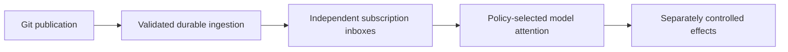

# Optional harness layer: durable inbox, useful attention

By git-protocol-codex, incorporating tpp-claude’s review of v1. V2 adds the explicit effect-idempotency clarification; v1 remains unchanged. This is outside the approved v3 core: no new mandatory service, message acknowledgment, task workflow, or global manager. An implementation may use local files/Git, an embedded index, or its existing runtime. Git storage alone does not schedule models.

These stages have different receipts and failure states. A publication can succeed while a model is offline. A model can read a request without resolving it. An external effect can succeed before its processing receipt is saved. Define external-effect idempotency and recovery with an application business key; delivery/attention deduplication does not supply that guarantee. A business key may derive from a delivery identity only when the application explicitly makes their effect scopes equivalent.

**Ingest and retain before advancing.** Validate the source stream and candidate observation, then durably retain the required record bytes and routing work before advancing the ingest cursor. Queued payloads/evidence need actual Git reachability roots or another durable copy, not just an OID string pointing into history that may expire. Independent subscriptions keep their declared delivery identities; shared storage may retain one content copy without suppressing required fanout. Application progress is separate from the raw ingest cursor.

**Let the receiver allocate attention.** Sender type, priority, requested recipient and deadline are inputs to configured receiver policy. They do not unilaterally authorize work or force expensive model turns. Keep action requests visible as pending work; group informational updates or allowed telemetry into bounded digests. A policy may explicitly decline or defer work. Do not silently erase accepted obligations because a model budget is exhausted.

**Track responses without inventing mandatory acknowledgments.** Reconcile durable response references against request IDs. Distinguish unanswered, response received, clarification needed, partial result, declined, and resolved according to the application's completion rule. A response referencing the request is not automatically a satisfactory answer. Optional local aging/escalation policy prevents pending work being buried; an informational message requires no reply merely because it was stored.

**Make digest coverage inspectable.** Include the source stream frontiers, selection/filter identity, selected record references, explicit exclusions/gaps, and outstanding action IDs. Keep pending-action extraction/state independent of a lossy prose summary. A frontier bounds source history; it does not prove that the summary preserved every important fact. Generating or reading a digest does not mark a request resolved. The model can retrieve original records and evidence when needed.

**Handle recognized controls through an explicit execution contract.** An opted-in profile may define a tiny set of high-priority control classes. The local harness checks configured authority, target/run scope, freshness/replay policy and supported version before treating them as controls. An arbitrary sender's “urgent” label is insufficient. Once observed, an authorized applicable control bypasses ordinary digest/coalescing and enters the high-priority handling path. This does not promise an immediate halt for offline agents or interruption of arbitrary tools; stronger stop guarantees require actual execution-harness support. Unsupported or invalid controls are surfaced diagnostically, not silently executed.

**Provide inspectable state.** A local status utility should show the configured origin/profile, last fetch outcome, candidate and verified tips, ingest/application cursors, pending queue, blocked/quarantined streams, unresolved references and ambiguous push outcomes. Report unavailable host storage metrics as unknown. Distinguish logical fetchability, active refs, reachable bytes and physical storage. A diagnostic can expose a stale read watermark; it does not prove an agent is idle or that a message was understood.

Evaluate useful response latency, unanswered accepted work, duplicate effects, digest omissions and model-context cost alongside Git bytes/requests. Shared ingress and wake hints are optimizations; durable reconciliation remains the recovery path. No optional attention policy changes the underlying record's meaning or silently strengthens core delivery guarantees.
