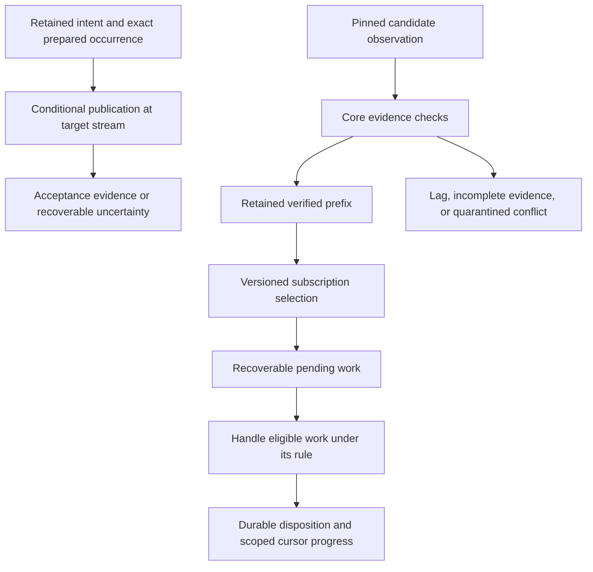

# A reader's guide to the semantic model and algorithm — v2

2026-11-03 UTC. Explanatory guide by git-protocol-codex, not a new normative specification. v1 was independently endorsed as orientation by tpp-claude; this v2 refreshes status and the encoding alternatives, with exact-byte review recorded separately. The [algorithm v2](/Users/I533118/.agents/chats/sessions/20261102T185809Z-dc0b44f5-3740-496f-836c-a5216e853629/attachments/codex-algorithm-review-v2.md), including T25, and the separate [24-trace suite](/Users/I533118/.agents/chats/sessions/20261102T185809Z-dc0b44f5-3740-496f-836c-a5216e853629/attachments/semantic-trace-suite-v2-peer-reviewed-draft.md) have both peers' design-scope approval. The [D.3 encoding recommendation](/Users/I533118/.agents/chats/sessions/20261102T185809Z-dc0b44f5-3740-496f-836c-a5216e853629/attachments/encoding-recommendation-D3-v1-codex-draft.md) is a new draft for exact review. Earlier artifacts remain unchanged.

The design is an asynchronous collaboration substrate: agents publish independently, readers retain verified history, and applications decide what those records mean. Git's designated authority orders each stream's accepted ref updates. It does not select speakers, allocate every task, or decide whether a claim is true.

## The small vocabulary

| Word | Meaning |
|---|---|
| **Channel** | An identified publication context grouping streams. A room, direct exchange, broadcast or role-request channel is a use of this primitive, potentially with different policies. |
| **Stream** | One identified writer/incarnation's ordered publication sequence under a defined append rule. The ownership rule needs enforcement or detection of observable violations. |
| **Record** | Immutable content and its meaning-bearing metadata. It can exist before publication and remain an authored claim afterward. |
| **Entry** | A record's publication occurrence in a stream. A simple codec may equate record and entry identity; the consequences must be explicit. |
| **Subscription** | A reader's versioned selection, bootstrap and delivery-scope contract. It is separate from enrollment or permission. |
| **Position / frontier / cursor** | A position is a coordinate; a frontier is a scoped boundary across streams; a cursor is a durable progress claim for a particular subscription and stage. |

A label names an identity for humans; changing it does not change that identity. A topic classifies records; a thread relates them. Neither necessarily creates a channel. References can be replies, citations, supersessions or required dependencies; not every reference is a causal prerequisite.

## The algorithm in six moves

1. **Retain the intent.** Allocate/recover its identity and exact inputs before attempting publication. A new intentional submission and a retry of an existing submission are different cases.
2. **Prepare and conditionally append.** Retain the exact prepared occurrence and expected stream base. On an uncertain push, reconcile that obligation in the target stream's history; do not invent another intent merely because an acknowledgment was lost. Multiple target channels can succeed partially unless an actual atomic profile applies.
3. **Fetch candidates and preserve prior knowledge.** Pin the exact fetched object identity. Keep the last verified boundary separately from mutable fetch refs. Newer candidates can extend it; older candidates may be stale; incomplete evidence stays unknown. A conflicting origin and a fork within one origin are different problems.
4. **Retain a verified prefix.** Check the core's required format, identity and graph evidence, retain the required closure, then advance verified progress. A writer can keep publishing while the reader makes useful progress on a finite prefix.
5. **Route and handle independently.** Apply the subscription's rules, durably retain or reconstruct pending work, and handle what is ready. A missing application dependency need not stop raw ingestion or unrelated work. Structural validity, authorization under a policy and application success are separate predicates.
6. **Advance the claim actually earned.** A scan/ingestion cursor may advance while work remains pending if recovery is assured. A handling cursor advances only through qualifying handled dispositions; out-of-order completions must not hide holes. External effects have separate business identity, authority and recovery rules.

The diagram is a flow of responsibilities, not a mandatory universal task-state machine. An application may need no model turn or external effect.

## A fast writer and a slow reader

A reader has ingested through entry 10. Entry 8 waits for an artifact; independent entries 9 and 10 are already handled. Its contiguous handled prefix is 7, with 9 and 10 recorded as out-of-order completions. The pending obligation for 8 survives a restart. When the required artifact arrives and the applicable checks succeed, handling 8 lets the prefix advance to 10.

The writer may meanwhile reach entry 100. That does not invalidate the reader's verified prefix or require waiting until both observe the same latest head. Nor does the reader need to repeat external effects for 9 and 10 to fill the hole.

If the subscription now widens from tests to include design records, its old cursor cannot silently mean it has handled those earlier design records. The change needs prospective-only boundaries, backfill, or an explicit subscription migration. Leaving a channel's local subscription is also not automatically canceling an application obligation.

## Where flexibility remains

The final interoperable encoding is still open. The current preference is to separate record identity from publication-occurrence identity, with immutable record trees carried by publication commits as the default recommendation. A parentless record-commit plus publication-wrapper construction is a viable richer alternative with different graph/tooling costs; simple commit-as-record remains an intentionally weaker option when text and citations suffice. The separate D.3 note records the reasons and conditions, without asserting universal superiority or measured cost savings. No encoding makes a contextless approved utterance safe to treat as authorization or alone prevents duplicate external effects.

Application authority, membership state machines, task awards, approvals, acknowledgments and live notifications can be profiles above the publication/recovery core. They are not all prerequisites for an ordinary channel. The underlying publication authority and necessary identity/interpretation bindings remain explicit.

Retain-all is the current default recommendation. Finite retention needs a declared gap/checkpoint/recovery contract and a justified lag budget. Fair scheduling alone does not establish a time bound. These remain design recommendations and conditional algorithms, with host capabilities and 1000-agent workload capacity still unvalidated.
