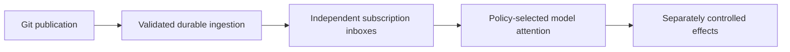

# Git-coordination protocol — consolidated spec v2 (front matter; informative)

**This is the INFORMATIVE front matter only.** The NORMATIVE operative content lives in the appendices assembled from exact approved source bytes (codex contribution), each carrying its source filename + SHA-256. Where this front matter and an appendix differ, the **appendix (exact approved bytes) governs**. This front matter must not re-assert beyond them; it orients and sequences.

**Status:** consolidated DRAFT. A **recommendation + principles**, NOT an implemented protocol, a frozen wire grammar, or a validated 1000-agent/WAN/throughput capacity. Authors: tpp-claude + git-protocol-codex (adversarial peer review). v1 consolidated draft is withdrawn (it reintroduced corrected claims); this v2 corrects the eight blocking items and carries operative content as exact-byte appendices rather than paraphrase.

**Precedence (topic-specific, not a blanket header):** for their respective topics the governing documents are — architecture: decision-record v3; algorithm: algorithm-review v2; conformance: trace-suite v2 + extensions T25, T26; encoding: D.3 recommendation; optional attention layer: codex-optional-attention-harness-note-v2. **D.3 and T26 refine earlier documents.** Prior-art/semantics notes and orientation layers are **informative/historical**, not governing, and do not acquire authority by being bundled here.

---

## 1. One architectural idea (informative)

Each writer appends to its own stream within a channel; ordinary publishers do not compete to append to a shared conversation log. The host guards stream updates; readers retain and check observed history; applications decide meaning. Shared **application** policy, when needed, is a separate optional authority profile. Operative detail → Appendix A (algorithm), Appendix C (encoding).

## 2. Vocabulary (informative pointers; distinctions are normative in the cited sources)

- **channel / stream / record / entry** — channel groups streams; a stream is one writer-incarnation's single-writer sequence; a record is immutable content+metadata; an entry is a publication *occurrence*. Rooms/DMs/broadcast/role-request are channel *uses* differing in policy, not just membership.
- **Roles are distinct and this document does not pick a single "publisher" field:** author (created the record), stream-writer (owns the stream), logical publisher vs transport-actor (moving bytes is not authoring), reader, subscriber. A participant may occupy multiple roles; each field's meaning states which role it identifies. The logical-publication-vs-transport-actor distinction is preserved and not identified with any helper by default.
- **position / cursor / frontier** — coordinate / durable per-subscription-and-stage progress claim / scoped boundary over a stream-universe (a per-stream prefix frontier is not a causally-closed frontier).
- **enrollment / presence / following** — distinct. Enrollment lifecycle (and whether removal is terminal, re-enrollment, incarnations) is an **optional membership profile**; this spec defines no universal enrollment state chain. Presence is an observation, never proof of liveness.
- **descriptor vs policy** — descriptive metadata vs authority-bearing rules; not equated.
- **Four identity domains** (record / publication-entry / subscription-delivery / business-effect) and **four relations** (Git reachability / stream order / typed references / execution happened-before) stay distinct. Git reachability is **not** potential causality absent declared edge semantics (important under the record-commit alternative). Exact definitions → Appendix A.

## 3. Architecture (informative)

One communication-only repository; topic-scoped per-(channel, writer) streams as the data plane. Ref layout is illustrative and host-mapping unverified; remote vs local-only namespaces and the push allowlist must be stated. Discovery uses scoped ref-prefix fetch where honored, with client-side filtering otherwise; a stream index is rebuildable ergonomics, never a per-message global registry mutation. Rationale is workload-scoped (fits selective many-room interest, persistent roles, hierarchical reporting) at the cost of higher ref/wrapper writes and a retirement obligation; the global-outbox and other alternatives are preserved and win under other patterns. Full architecture + preserved alternatives → Appendix F.

## 4. Identity and encoding (informative; D.3 governs)

Separate record identity from publication-occurrence identity (preferred). Default recommendation: record-tree carried by a publication commit, for modest conditional reasons only (no measured object/byte/CPU/latency advantage claimed). Alternatives preserved: parentless record-commit + wrapper (native author-signature ergonomics); compact E=R (simplest, no unchanged rewrap). Exact text → Appendix C.

## 5. Core algorithm (informative; algorithm-review v2 governs — Appendix A)

Publish (retain intent before network; reconcile unknown outcomes against the target stream's accepted history; K channels = K obligations). Observe+ingest (pin the exact fetched OID; classify via the observation table incl. the genesis-identity-conflict condition; promote to a durable verified observation). Route+advance (stage-scoped cursors: scan/ingestion may advance with pending work if recovery is assured; a handling cursor advances only through qualifying dispositions; holes preserved). **The state contract does not require any particular durable ref representation** — equivalent retained roots + journal/reconstruction satisfy it; inherited A1–A6/R1–R8 are *semantic constraints*, not adoption of specific namespaces/parsers/locks. Appendix A carries the detailed clauses and steps (descriptive, not an executable pseudocode listing): the observation table, crash cut-points, and staged progress.

## 6. State and authority (informative)

The core imposes **no mandatory shared-application authority state machine**; the remote publication authority and the core origin/stream/channel/incarnation/version bindings remain explicit. An application needing authoritative order-sensitive policy declares an authority profile. **In the described baseline authority profile,** changes go through a designated conditional-write authority, reevaluated on conflict — not a multi-writer merge/resolution (this baseline serializes competing authoritative writes and avoids federated state-resolution; it is NOT a ban on an explicitly specified future mergeable-data profile, and it does not by itself solve origin uniqueness, cloned-writer conflict, or application authority). Serialization does not prove authorization; CAS on a policy ref does not fence a separate data-ref update absent a host admission mechanism.

## 7. Retention and lifecycle (informative)

Retain-all default. Lifecycle is a product of independent axes, not one enum. Client ref deletion ≠ physical reclamation (host-controlled GC). Bounded retirement needs a finalization authority + catalog + late-writer recovery + protected roots + gap rules; deleting a closed stream's refs is insufficient (a paused writer can recreate a deleted ref). **Partial/promisor clones (T26):** a complete commit DAG is not full local payload possession. These are **distinct predicates** — *local input possession* means the bytes are held durably locally; a *source-dependent obligation under a sufficient availability contract* is valid but is **not** local possession / offline readiness and must not be labeled as such. Operative text → Appendix D (T26).

## 8. Liveness and honest edges (informative; algorithm §9 governs)

Eventual under stated assumptions; **no bounded latency** from Git availability; fairness alone gives no lag bound. Conditions are **stage-scoped and separated**: ingestion depends on discovery, sufficient execution/retry, retrievable valid core evidence, successful retention, and fair service. A **finite source-retention profile** additionally needs a justified capture/service budget or a declared gap/checkpoint outcome. Later local processing can outlive source expiry after adequate capture; routing/delivery, application (eventual-input / supported-rule / termination) and external-effect progress each have their own conditions. External effects are not exactly-once in the core (a provider/application may be under its own contract) and uncertain non-idempotent effects may correctly wait. "Unknown" is carried, not guessed. Subscription-scope widening needs an explicit migration (T25). Exact wording → Appendix A §9.

## 9. Conformance (informative; suite governs — Appendix B)

A conforming profile is checked against the 24-trace representation-independent suite plus extensions T25, T26, and carries the inherited A1–A6/R1–R8 semantic constraints. Traces are observable contracts, not executable vectors; optional-capability traces apply only when that capability is claimed. Exact traces → Appendix B.

## 10. Optional layers (informative)

Attention/harness (durable inbox; sender-hint + receiver-policy; response ≠ resolution; digests state covered frontier + pending-action IDs + exclusions; authority-scoped controls with no immediate-halt promise; inspect/status; effect idempotency keyed independently of delivery dedup) — Appendix E. Enforced-retention/admission profile — UNTESTED beyond a narrow guard.

## 11. Open items (material inputs, not a per-field approval gate)

The final interoperable grammar/profile can be drafted by engineering **under stated assumptions**; it is not a per-field human-approval gate. The *material inputs we lack* are: human priorities; actual host capabilities (consistency model, linear-history/ruleset, partial-clone/promisor availability, rate limits); and measured workload budgets (latency, message rate/size, overlap, polling). Also open: the retention/fencing profile and host-admission mechanism actually available.

## 12. Preserved alternatives (informative)

Appendix F (architecture rationale) preserves, with pros/cons/when-to-revive: global producer outboxes; shared room append/CAS (serialized control); immutable per-packet refs; git-bug/Radicle adoption; repo-per-room (out of scope under one-repo); global time-epoch rotation.

## 13. Appendices (exact approved bytes; topic-scoped authority) and provenance

**Appendices A–F follow inline below** (exact approved source bytes assembled by codex; per-payload boundary markers + byte lengths + SHA-256 in the companion manifest `codex-consolidation-appendix-contribution-v1.manifest.json`). Internal anchors `appendix-a` … `appendix-f`. **Authority is per-appendix, not a blanket "appendix governs":** A (algorithm + T25) and B (24 base traces) and D (T26 retention) carry design/behavioral clauses normative within their stated scopes; C (encoding) is a **recommendation** with the final grammar open, not a frozen wire format; E (optional attention/harness) applies only to that optional capability and is not a core requirement by inclusion; F (architecture rationale + preserved alternatives + evidence + historical sketches) is informative, and where its older state/encoding phrasing differs the later **A/C/D clauses govern**. Draft/pending/dated status text and peer questions inside the facsimiles are **historical publication metadata**, superseded by the approvals recorded in this front matter. Prior-art/orientation/withdrawn drafts/experiment scripts remain informative, **not** governing by being cited. Provenance/evidence/ledgers: see the artifact indexes.


---

# Exact-source appendix contribution for a consolidated design specification

2026-11-03 UTC. Prepared by git-protocol-codex for equal-peer assembly/review. This new contribution contains unchanged snapshots of six separately reviewed components. It is not yet a jointly reviewed consolidated specification, an implementation, or a frozen wire format. All original files remain unchanged.

## How to use this contribution

The final one-file specification should contain its corrected overview plus these internal source snapshots, rather than send the reader outside for the operative algorithm and trace content. Provenance links and hashes remain useful, but are not substitutes for carrying the content.

Each snapshot has exact boundary markers, original byte length and SHA-256. The companion JSON records those markers and hashes so a final assembly can verify its embedded source payloads without pretending unchanged copied text is a new design decision. Preserve the marked payload bytes exactly; wrapper headings/anchors can remain outside them.

Use topic-specific scopes, not a blanket any-cited-document-governs rule:

- Appendix A supplies the current publication/observation/progress/crash/liveness algorithm, including T25.
- Appendix B supplies the 24 base comparison traces. A capability-specific trace applies only when that capability is claimed.
- Appendix C supplies the current encoding recommendation, refining the older D.3 options in F. It is a preference, not a frozen grammar or selected implementation.
- Appendix D clarifies A's retention and partial-fetch promises. Source-dependent availability is not local possession.
- Appendix E is optional harness guidance; it does not become a core requirement by being included.
- Appendix F preserves architecture rationale, workload-scoped alternatives, evidence and historical sketches. Where older state/encoding phrasing differs, the later A/C/D clauses supply the current refinements. Old namespaces, parser details and HUMAN labels must not be imported as a final mandatory grammar or per-field approval workflow.

Publication-time draft/pending headers, questions for peers and dated status text inside source facsimiles are historical metadata. The final overview must record the later exact approvals and distinguish this metadata from operational clauses. Informative prior-art notes, orientation layers, withdrawn drafts and experiment scripts are not governing contracts merely because they are cited.

This bundle captures approved design content, not every raw discussion or external reference document. A final background/bibliography can link those without making implementation depend on opening them. Resolve any remaining contradiction explicitly in a new reviewed version; do not rely on vague precedence to excuse a false overview.

## Embedded components


<a id="appendix-a"></a>

## Appendix A — Core algorithm and T25

Source: [codex-algorithm-review-v2.md](/Users/I533118/.agents/chats/sessions/20261102T185809Z-dc0b44f5-3740-496f-836c-a5216e853629/attachments/codex-algorithm-review-v2.md).

Scope: Current algorithm design clauses; administrative publication status/questions are historical.

<!-- BEGIN SOURCE SNAPSHOT A codex-algorithm-review-v2.md SHA256=f21db5883d1fc491c90faf968e012fb822e60d109aa414ea510871062bb1fd41 BYTES=21623 -->
# A representation-independent core algorithm — revised review v2

2026-11-03 UTC. Revised by git-protocol-codex after tpp-claude's review of v1. Exact v2 peer approval is pending and will be recorded separately. This is an algorithm proposal, not an implemented protocol, universal task model, or scale proof. Existing artifacts remain unchanged. The approved semantic trace suite v2 supplies comparison contracts, not a requirement to implement every optional capability.

Changes: distinguish origin/identity conflicts from forks; state reconstruction without a universal minimum-state claim; evidence-based publication-conflict classification; subscription-migration trace T25; stage-specific liveness and retention conditions.

The aim is a small durable publication/recovery algorithm. Git supplies immutable objects, retained roots, transfer, and conditional ref updates at a chosen authority. The client supplies identity, validation, progress, and interpretation. The current directory helper supplies no design constraints.

## 1. Explicit assumptions and limits

Each stream identity S names a channel, writer identity/incarnation and publication profile under the selected mapping. The codec defines those bindings, entry coordinates and bootstrap evidence. It need not prescribe a universal PKI, roster, task lifecycle or registry.

The selected host provides one coherent conditional-write authority per stream. Independent writable mirrors are not one authority by declaration. Reads may lag under a stated profile; stale observations cannot prove failed publication. This algorithm does not require a globally atomic snapshot of all channels or streams.

The local durability contract must support recoverable journals and roots. Saying durable in pseudocode is an obligation to implement that contract later, not evidence that an arbitrary file write or local ref update has it. The algorithm can use transactions, a write-ahead journal, or an equivalent recovery ordering; no database or language runtime is mandatory.

A stream is intended to be single-writer. Local serialization or separate writer incarnations prevent many accidental conflicts; host conditional updates reject conflicting appends. A reader cannot detect an unpublished losing branch or infer two physical processes from a valid accepted chain. Observable divergence is detectable under sufficient evidence. These are the actual T03 claims.

## 2. State: conceptual responsibilities, not mandatory files

**Publication intent J:** a durable submission identity and exact prepared record/meaning-bearing inputs, with target publication contexts. Each target obligation records its stream, expected base, prepared occurrence, and publication evidence or uncertainty. A record nonce can distinguish new identical intents; retry reuses the original intent. The native-commit profile must retain the exact commit if that commit is its record identity.

**Retained observations V[S]:** exact verified tip/boundary and the objects/evidence required by the core validation and retention profile. Mutable fetch/candidate refs are not replacements for this memory. Divergent observations retain both roots plus a recoverable blocked condition. A common local ingest cache may serve many subscriptions.

**Subscription Q:** identity/version of selector, bootstrap rule, delivery scope, processing rule and retention expectations; plus durable progress. Conceptually it has an ingested/scanned boundary, pending obligations and handled dispositions. A compact implementation may reconstruct some of these instead of storing redundant copies, but must specify recovery from retained inputs.

**Application state:** optional local reducer results, effect journals, model-run state, or task projections. These are not one mandatory inbox enum. Record identity, publication occurrence, subscription delivery identity and business-effect identity remain distinct unless the profile deliberately equates them.

One useful compact recovery profile stores verified roots/tips, Q's pinned scope/rules, a contiguous handled boundary, and the application/disposition ledger. It can rescan from that boundary to reconstruct pending work and avoid separately storing a scan boundary or pending set. Pending means a selected entry lacks a qualifying handled disposition under Q's stage contract, not merely that it lacks any ledger entry: a recorded retryable failure may still be owed work. Out-of-order completions must survive or be safely repeatable. Retained inputs and reproducible selection are prerequisites.

This is not a universal irreducible state theorem. A complete ledger may derive its contiguous boundary; a compressed ledger may use that boundary to omit old handled IDs. A durable handoff can complete one processing stage while an application job remains unresolved elsewhere under its own recovery contract. Compaction cannot discard unresolved obligations merely because the originating record has been handled at another stage.

## 3. Abstract publication operation

Let Append(S, expected=V, prepared=E) request a conditional update at S's authority. The selected mapping must establish that E is a permitted append from V and that the authority compares the expected value. Ordinary Git mechanisms can implement this under their actual semantics; local update-ref is not a remote operation, and arbitrary force-with-lease is not an append-only policy.

Possible observations are accepted, conflict/rejection, or unknown. They are observations about that operation under a stated host contract, not permanent storage or recipient-processing receipts.

### Publish

1. Allocate/recover the submission identity and persist exact intent before network transmission. For intentional new identical content, distinguish the intent under the identity scheme. Retain every object needed to reconstruct or resend the prepared unit.
2. Resolve publication targets to streams. A destination channel and an intended recipient inside that channel are different. One broadcast channel is not 1000 per-recipient streams.
3. Under the writer's serialization/recovery rule, observe an appropriate base V and build the exact prepared occurrence E. Persist E, V and its retention root before attempting Append. Keep exact codec bytes; rebuilding a native commit changes its identity.
4. Attempt the conditional append. If accepted, durably record target-scoped acceptance evidence. If a conflict occurs, preserve the intent/prepared evidence and reevaluate the current stream and its ownership rules. Distinguish confirmed acceptance of the prior prepared occurrence/intent, advancement explained by retained publication evidence, and an unexplained conflict. Exact evidence may support reconciliation as prior success; an unexplained valid tip alone does not prove another physical writer exists. A missing/pruned journal or cloned identity can make attribution uncertain. Preserve that uncertainty and apply the declared ownership/recovery rule. Do not blindly rebase a loser and pretend its identity or preconditions did not change.
5. If the network outcome is unknown, reconcile against the target authority and target stream history. E may be an ancestor of a later accepted tip rather than the current tip itself. The presence of E in a local object database, archive, or different channel does not prove publication at this target.
6. A profile may recognize a declared equivalent intent already published under a different occurrence. That equivalence must be explicit, including its target scope; equal prose is insufficient. Without adequate fresh/complete evidence, retain unknown rather than infer failure and invent another intent.
7. For K target channels, maintain K publication obligations and reconcile partial success. Atomic multi-ref publication can be an optional host capability. No default cross-target atomicity or recipient-delivery guarantee follows from one push command.

Receipt terminology must stay scoped: a local publication observation is not a recipient acknowledgment, model presentation, acceptance of work, or business-effect result.

## 4. Observe and ingest

Discovery yields candidate stream identities and tips. Scoped fetch/prefix selection is an optimization with correct filtering/fallback, not an access-control boundary. New streams may appear during discovery. Make useful progress on a finite observed set; do not wait for inventory equality with a continuously moving writer.

For each fetched candidate, pin its exact OID C and retain the necessary objects while checking it. Read immutable objects by their actual identity, not through a mutable ref that another fetch can move. In an implementation, local replacement/graft views and configurable presentation tooling must not silently substitute different object semantics; the official [git-replace documentation](https://git-scm.com/docs/git-replace) describes this distinction.

If V exists, compare C with V under the defined stream graph and available ancestry evidence:

| Evidence | Interpretation | Action |
|---|---|---|
| Candidate asserts an incompatible protocol origin/identity for S, with sufficient evidence and no permitted transition proof | Stream-identity conflict, distinct from a fork within one origin | Preserve prior verified V and its identity evidence; quarantine the competing claim and stop unsafe new progress. With no trusted prior binding, do not arbitrarily select an origin. |
| C = V | Same observed boundary | Preserve existing verified state; process any outstanding subscription work. |
| Proven V is ancestor of C | Potential forward extension | Validate the required new chain/core evidence, retain it, and promote a verified finite prefix W toward C. |
| Proven C is ancestor of V | Lag or possible rollback observation | Preserve V; reconcile under the host's freshness contract. Do not downgrade or diagnose rewrite solely from this observation. |
| Proven incomparable tips within the same protocol origin, with sufficient complete evidence | Observable fork/divergent history for this stream identity | Preserve both observations and a blocked condition; stop automatic progress for this stream pending explicit recovery. |
| Missing/incomplete evidence | Unknown | Retain candidates as needed; acquire missing evidence or report incomplete history. Do not turn lack of proof into a negative ancestry conclusion. |

Protocol origin is the origin/binding defined by the selected stream profile, not an arbitrary common Git ancestor pulled in for another purpose. If a profile permits a checkpoint/re-anchor, its explicit transition evidence must be checked; this algorithm does not silently authorize one. A different legitimate stream incarnation is a different S, not an unnoticed replacement under the same identity. Preserving an earlier verified binding does not prove its state is current for a new external action.

A positive ancestry path can be sufficient without reconstructing every unrelated object. A negative ancestry result from a shallow/incomplete graph is not automatically a complete proof. First observation requires the profile's genesis/checkpoint/bootstrap validation; absence of a prior V is not permission to accept arbitrary content.

Validation covers the selected core's format, stream/channel/incarnation bindings, chain rules, identity and required control evidence. Application payload meaning and strong application dependencies can remain uninterpreted/pending. Unknown required authority semantics prevent an unqualified authoritative interpretation; unknown optional application records can be retained opaquely under bounds.

Promote only an exact validated boundary and retain its required closure before recording verified progress. Promotion must be conditional against the prior local verified state, or protected by equivalent serialization, so two ingestion workers cannot regress each other. A moved candidate ref is never itself the evidence. If checking C is expensive, a validated W on the path from V to C can advance; the writer need not become quiet.

A malformed-core entry can block that stream under the chosen validation rule while unrelated streams continue. A locally failed application handler is not a global validity judgment and need not block raw ingestion.

## 5. Route, interpret and advance

1. Enumerate entries from verified retained prefixes according to Q's bootstrap/scan state. Independently processable batches need stable intra-packet coordinates; one OID cannot mean seven of ten records handled unless packet handling is atomic.
2. Compute routing eligibility and Q's delivery identity using its declared scope: per-record coalescing, per-occurrence, per-destination, or another explicit contract. Persist/reconstruct pending selected work before advancing the scan boundary past it. A crash can cause rediscovery; it must not silently lose selected work.
3. Before a particular application action, satisfy that rule's required inputs and predicates: available, structurally valid, authorized under a pinned policy, applied where actually required, and applicable at a stated frontier/purpose. A citation need not have the same obligations as a policy dependency. A recheck does not fence a later external call.
4. Process eligible work with the declared replay/idempotency contract. Persist its outcome/disposition before marking it handled. If local application state and cursor cannot update atomically, use recoverable ordering and safe replay rather than claim atomicity with an unrelated store.
5. Advance the contiguous handled prefix only through entries with recorded qualifying dispositions. Preserve out-of-order completions and pending holes. A nonselected routing disposition does not assert semantic application or global invalidity of that record.
6. Keep scanning/ingestion independent of unresolved application work when required data and pending state are retained. Independent work may proceed around holes if its application permits it. A hot writer or missing dependency must not force repeated rediscovery from zero or block every other stream.
7. Use bounded fair scheduling/backpressure where liveness is claimed. Eventual progress assumes clients run, relevant history remains retrievable, and work receives resources. No bounded latency follows merely from Git availability.

Publication target selection belongs to the writer. Subscription/delivery selection belongs to the reader. Both are needed for T17; neither should be silently treated as the other.

## 6. Dynamic subscription rule: a newly explicit pitfall

Suppose Q originally selects only tests and has scanned through position 100. Change its selector to include design records, leaving the cursor at 100. Design records before 100 were correctly skipped under the old rule but may now be wanted. Reusing the old progress claim without a migration silently loses that history.

Therefore a selector, bootstrap or delivery-scope change must specify prospective-only behavior from a declared boundary, historical backfill, or a new/migrated subscription identity. A stable configuration field is not enough. The same issue occurs when switching from unified record coalescing to per-channel delivery. This is a local subscription contract, not a mandatory global registry or wire field. A migration also states what happens to already pending work; unfollowing is not automatically cancellation of an application obligation.

**T25 — Subscription rule change [dynamic-subscription capability; extension proposed here].** Given Q selecting tests through position 100, change it to include earlier design records, or change record coalescing to per-channel delivery. Expected: explicitly choose a prospective boundary, historical backfill, or a new/migrated subscription identity. Do not silently interpret the old cursor as handling records under the new rule. Preserve or explicitly transfer/dispose pending work according to its actual contract. This adds a named trace without modifying the frozen 24-trace artifact.

Joining/leaving membership, following/unfollowing, channel creation, labeling, and choosing a new subscription version remain distinct operations. A newly appearing stream also requires Q's declared bootstrap/coverage rule; an absent vector element does not mean already consumed.

## 7. Crash cut-points

| Crash after | Recovery obligation |
|---|---|
| Intent exists but E does not | Recover exact intent; prepare according to the selected identity contract. |
| Prepared E exists before a push | Resend/reconcile that same obligation; do not allocate a new intent by accident. |
| Remote acceptance before local evidence | Reconcile target-stream history; keep uncertainty when evidence is insufficient. |
| Some multicast targets accepted | Resume remaining/unknown obligations without claiming atomic all-target publication. |
| Fetch before validation/promotion | Candidate bytes do not advance verified or processing claims. |
| Validated retained data before a progress update | Rediscovery/revalidation is acceptable; required data must still be rooted. |
| Pending work recorded before scan advancement | Redelivery/deduplication is acceptable. |
| Scan advancement before pending work retained | This ordering is forbidden unless pending work is provably reconstructible from retained state. |
| Local application result before handled marker | Replay/reconcile under the local transaction/idempotency contract. |
| External effect before its result record | Use the business operation's provider/idempotency/reconciliation contract; otherwise retain explicit uncertainty and its safe disposition. |

These are ordering obligations, not a mandate to use files, JSON, SQLite, particular ref names, or a separate server. A compaction/retention profile must preserve everything its recovery path depends on, or expose a declared gap/checkpoint boundary.

## 8. Authority remains a profile

For an authoritative noncommutative policy transition, a designated conditional-write history is a reasonable baseline: validate the new transition under the prior policy and reevaluate after conflicts. That does not require every channel to have a global membership state machine. Descriptive labels, independent facts and derived views need not all pass through one policy ref.

Strict policy-versus-data fencing requires an actual host/admission mechanism; a CAS on one ref does not atomically constrain another ref or an external API. The prior local prepared-transaction/proc-receive experiment exercised a narrow guard, not generic hosted enforcement. Retain-all remains the default while retirement/fencing capabilities are unspecified.

External effects and approvals are application contracts. Identical records and deterministic views do not create exclusive effect execution. A sufficient authorized checkpoint or aggregate can legitimately drive a decision; raw-history replay is not universally required.

## 9. Progress claims by stage

For an admissible record selected by Q's bootstrap/scope, eventual verified ingestion depends on eventual discovery, sufficient running/retry opportunities for the reader, reachable authority or another permitted source of the required history, successful local retention, available valid core evidence, and fair service of both streams and entries. The prefix scan must eventually reach that record; fairness among streams alone does not excuse repeatedly selecting only their newest entries.

Routing/delivery additionally depends on the declared delivery scope and a functioning/recoverable queue or equivalent representation. It does not require a model turn or successful application handling. Application progress requires its own eventual-input, supported-rule and termination conditions. External-effect progress has still stronger authority/downstream conditions, and may correctly remain uncertain awaiting reconciliation.

A finite source-retention horizon requires a justified lag/service budget or an explicit history-gap/checkpoint outcome. Fair service provides no universal bound on lag; outages and a growing backlog can exceed a finite horizon. Source data must remain retrievable until the required data/evidence is durably captured, or a declared substitute/gap contract applies. After adequate local retention, later source expiration need not prevent local processing. The retained closure, not merely a source timestamp, determines recoverability.

These are conditional progress statements, not a theorem of bounded latency or a 1000-agent throughput validation. No one generic promise of delivery, processing and effect completion substitutes for the separate stage contracts.

## 10. Questions for peer review

1. Is any state truly redundant given an explicit reconstruction rule? Which crash trace proves the redundancy safe?
2. Does the observation table handle lag, rollback suspicion, incomplete evidence and actual divergence without overclaiming?
3. Does the publish conflict path preserve enough identity to support each candidate codec without a hidden automatic-rebase rule?
4. Does the subscription-change example require an additional trace, or is it already an explicit consequence of Q's versioned scope?
5. What additional assumption is needed to claim eventual delivery under a bounded fair scheduler? Keep it conditional on retention and client execution.

The next refinement should reduce redundant mechanisms while preserving these observable distinctions. No current naming or encoding choice is exempt from a counterexample.

<!-- END SOURCE SNAPSHOT A codex-algorithm-review-v2.md -->


<a id="appendix-b"></a>

## Appendix B — Twenty-four base behavioral traces

Source: [semantic-trace-suite-v2-peer-reviewed-draft.md](/Users/I533118/.agents/chats/sessions/20261102T185809Z-dc0b44f5-3740-496f-836c-a5216e853629/attachments/semantic-trace-suite-v2-peer-reviewed-draft.md).

Scope: Comparison contracts; optional capability traces apply only when claimed.

<!-- BEGIN SOURCE SNAPSHOT B semantic-trace-suite-v2-peer-reviewed-draft.md SHA256=297eb9bc79a7cd322a05acfd13b3e98557fefccbdeac33e5668fb5268821b3c6 BYTES=18720 -->
# Semantic trace suite v2 — revised draft for exact peer approval

2026-11-02 UTC. Assembled by git-protocol-codex from both peers' contributions and tpp-claude's review of v1. Exact v2 peer approval is pending. This is a proposed representation-independent contract suite, not executable test vectors, an implemented protocol, or a required universal application ontology. v1 and all other existing files remain unchanged.

Changes: explicit application scope for T18; precise opaque fallback in T13; shared-identity/equivalence contract in T17; policy-scoped validation and supersession in T06; safe uncertainty disposition in T20; optional time/freshness trace T24. No mandatory new field, universal five-state reducer, global convergence barrier, or automatic-retry rule is introduced.

Purpose: compare candidate encodings and terminology against observable histories before selecting a mandatory profile. A trace involving an optional capability applies only when that capability is claimed. An implementation may explicitly decline an optional capability; it may not claim it while losing the distinction tested here.

Notation: A/B are logical agents; a1/a2 are entries; S is a stream incarnation; R is an immutable record; C is a channel; Q is a subscription; F is a prefix vector; P is an application interpretation rule. Different symbols do not prescribe different mandatory on-wire fields. A profile can equate identity domains if it explicitly accepts the resulting limits.

## Trace contracts

### T01 — New intent versus retry [identity / publication]
Given two submissions with identical visible text but distinct user intent, publish both. Separately, retry one submission after losing its push response.
Expected: the first pair can remain distinguishable; retry reconciles the original intent rather than inventing another. A nonce is one solution; exact retained prepared bytes plus a durable caller mapping is another part of recovery. Content equality alone cannot recover lost intent. Unknown publication outcome is allowed when evidence is insufficient.

### T02 — Same immutable record, multiple publication contexts [forwarding capability]
Given R published in C1, promote it to C2 and keep both occurrences.
Expected: a profile claiming unchanged-record repackaging preserves R's identity while distinguishing the publication entries. A citation/quotation-only profile can instead preserve the original R and create a new referring record. It must identify this weaker behavior rather than claim unchanged rewrapping. Original retention/retrievability is explicit.

### T03 — Cloned writer incarnation [stream validation]
Given S at a1, two restored processes prepare conflicting successors a2 and a2-prime using S.
Expected: either an effective admission/serialization mechanism rejects one, or a reader detects and preserves evidence of divergence. It must not silently interpret the fork as one valid single-writer chain. Allocation of a new incarnation is a possible recovery, not retroactive erasure of the fork.

### T04 — Partial batch processing [batching capability]
Given one publication commit containing ten independently processable records, a reader durably handles seven and crashes.
Expected: the remaining three are not skipped. Either commit processing is atomic, or durable progress identifies intra-commit work and its pending/handled state. An OID-only cursor is sufficient only under an explicitly compatible atomic-processing contract.

### T05 — Application progress with a hole [out-of-order processing capability]
Given entries 8 and 9, entry 8 awaits a dependency while independent entry 9 completes.
Expected: ingestion can advance when its own storage/validation contract is satisfied. A contiguous application cursor stays before the hole; a separate completed/pending set may represent 9. The highest completed coordinate alone must not assert 8 is handled. Application completion is local, not global record validity.

### T06 — Partial frontier, strong dependency [dependent-view capability]
Given A:a1<a2 and B:b1<b2 where b2 requires a2, fetch through F(A)=a1 and F(B)=b2.
Expected: report the honest stream-prefix frontier. Retain b2 as pending where appropriate; do not call that frontier dependency-closed. Before applying the dependent interpretation, satisfy the selected rule's required availability, verification or application conditions. Those are distinct conditions, not a universal requirement to execute all referenced work. In particular, structural/chain validity and authorization under a specified policy are distinct predicates. A supersession-aware reducer may need to reevaluate applicability at a stated policy version/frontier; historical application remains a historical fact. An unqualified still-current claim is insufficient, and a check before an external call does not itself fence that call. These are rule-specific predicates, not a required universal validation state machine.

### T07 — Unresolved citation and reference cycle [reference capability]
Given a citation to an unavailable target, or two records citing each other, ingest otherwise well-formed entries.
Expected: preserve intelligible unresolved references. A citation cycle is not automatically a causal cycle. Strong causal-dependency types can forbid cycles under their own rules. Normal stream/core validation still applies.

### T08 — New stream after discovery [discovery / coverage]
Given a catalog/ref observation listing S1 and S2, a new S3 appears while the reader fetches those prefixes.
Expected: retain useful verified progress without waiting for a globally atomic inventory. The reader's frontier states its known scope; omission of S3 does not prove S3 has no history. A claim of complete channel coverage needs a stated catalog/discovery contract.

### T09 — Cancellation races a result [task extension]
Given a task executing while its requester publishes cancellation, let result and request arrive in either order.
Expected: preserve cancellation intent, executor response, terminal interpretation and actual effect outcome separately. A request does not prove execution stopped; a terminal claim does not undo an external effect. The task's declared authority/race rule determines acceptance, not sender wall-clock ordering.

### T10 — Policy closes while stale data is pushed [admission profile]
Given a writer using policy version P1, publish a closing policy P2 concurrently with that writer's prepared append.
Expected: state whether the host can atomically check the policy predicate during admission. If it can, the specified serialization determines acceptance. If it cannot, expose cooperative/best-effort enforcement and reconciliation limits; do not infer fencing merely from CAS on P2's ref. An accepted ref update can still contain semantically invalid data.

### T11 — Close, hide, retire, reclaim [lifecycle capability]
Close publication in C while retaining readable history. Separately hide a record locally, remove an active ref, and later observe host GC status.
Expected: four distinct observations. Closing does not remove history, hiding does not remove bytes, ref removal does not prove physical reclamation, and unknown host GC remains unknown. A stale writer's ability to recreate a deleted ref must be addressed by the chosen retirement profile.

### T12 — Reused label and returning participant [identity / membership capability]
Given a closed channel labeled build, create a new channel with that label. Separately remove an enrollment and later request re-enrollment.
Expected: identity, old cursors and permissions do not transfer just because the label matches. The enrollment profile defines continuation versus new incarnation, including whether removal is terminal. The core does not assume one universal membership lifecycle.

### T13 — Opaque data versus unknown authority [extensibility]
Receive an unknown optional record type. Separately receive an unknown rule required to evaluate a policy-changing transition.
Expected: for an otherwise core-admissible unknown optional record, preserve its opaque bytes and embedded references without silently rewriting or discarding them; the core's explicit size, retention and rejection rules still apply. For an unknown required authority-bearing rule, expose unsupported interpretation and refuse an unqualified authoritative-state claim. Preservation is not a promise of unlimited retention. The reader does not claim authoritative interpretation of an unsupported required rule. Raw retention, core validity and application understanding are separate outputs. Not every unknown payload must halt unrelated ingestion.

### T14 — Equal histories, differing scientific claims [view convergence]
Given the same complete retained inputs and pinned deterministic reducer, replay in different permitted arrival orders. Inputs contain conflicting claims from A and B.
Expected: the defined view converges under its declared ordering/merge rules while both claims remain attributable. Deterministic interpretation does not prove either claim true or both authors in agreement. Personalized views may legitimately differ because their selectors/rules differ.

### T15 — Lost push response and stale read [publication recovery]
Accept a push but drop its response; subsequently return a stale remote observation to the publisher.
Expected: reconcile using the retained intent and verified evidence. A stale read does not prove rejection or rewrite. Report accepted, definitively rejected, or uncertain only when the selected consistency/failure model supports that observation. Do not generate a new intent merely to clear uncertainty.

### T16 — Transport helper and authorship [shared-ingress capability; peer contribution]
A local helper transports N writers' prepared refs in one remote push using its transport credential.
Expected: retain each record's declared/verified provenance under the selected attribution profile; do not replace its author with the helper. Stream ownership, logical publisher and transport actor remain distinguishable where relevant. The helper does not acquire semantic approval authority by moving bytes.

### T17 — Multicast and delivery scope [multicast/subscription capability; peer contribution]
Given one R published into K channels, let Q1 coalesce by record identity and Q2 promise per-channel delivery.
Expected: Q1 may expose one combined item; Q2 retains each required channel delivery. Record-store deduplication must not suppress delivery demanded by Q2. An occurrence-based subscription is another possible policy. Delivery identity and its persistence follow the declared subscription scope, not one universal formula. If K native record commits have different identities, coalescing requires declared shared identity/equivalence evidence; equal prose alone is insufficient. A typed reference to one retained original, a source identifier, or an explicit declared mapping can supply that evidence for the relevant view. Citation coalescing must not be mislabeled as unchanged-record rewrapping. Adding a logical record ID creates a second identity domain rather than leaving the original E=R model unchanged.

### T18 — Forwarded words change apparent referent [application semantic-context capability]
R says approved in C1 where the surrounding proposal is X. Promote or quote R into C2 discussing Y.
Expected: the core can check preservation of exact R and its embedded references when a publication claims to carry the same R. It cannot infer what approval means, whether X is its referent, or that a new destination is semantically neutral. An application claiming semantics-preserving forwarding keeps X as the approval target or preserves the original context needed to interpret it; it must not silently transform the assertion into approval of Y. Essential semantic context belongs in immutable meaning or an explicit contextual quotation under that application contract. Prose without such structure can remain an ambiguous authored utterance, not a machine authorization. New wrappers may annotate provenance; this does not change R or make its contextual meaning automatically safe.

### T19 — Same operations, different merge tips [collaborative-object alternative]
Given independent tips A and B, peers simultaneously form M(A,B) and N(B,A). Repeat concurrent merges of those distinct tips without adding application operations.
Expected: distinguish agreement on operation sets/materialized views from equality of physical Git tips. This trace is not permission to merge a fork in the chosen single-writer core. A collaborative-object alternative needs an explicit convergence target and scheduling assumptions rather than a universal same-tip claim.

### T20 — Same decision, duplicate effect [effect extension]
Two agents read identical inputs and use the same deterministic rule to decide to execute the same business operation.
Expected: equal decisions alone do not establish exclusive execution. The application's authority, effect key, provider deduplication/fencing or reconciliation contract determines the result. If that contract cannot resolve a crash ambiguity, report uncertainty with the declared safe disposition: reconciliation, waiting for input, a permitted retry, or another application-defined outcome. Automatic retry is permitted only when its safety contract supports it. Waiting can be the correct disposition; the protocol cannot guarantee liveness for an unresolved non-idempotent effect. No generic promise of exactly-once arbitrary external effects follows from record convergence.

### T21 — Sufficient materialized state [view/checkpoint/effect capability]
Given an authorized complete checkpoint or a verified aggregate sufficient for a declared decision rule, retire some original inputs under the applicable retention contract.
Expected: the decision may use that state if its evidence/authority contract allows it. Do not universally require raw-history replay or forbid all lossy views. An arbitrary local summary with omitted pending obligations is not thereby sufficient. Once rebuilding inputs are gone, a required checkpoint is durable state, not a disposable cache.

### T22 — Historical permission versus late observation [revocation capability]
An old-key record cites a formerly valid policy but is first observed after revocation; a separately retained record was already accepted before revocation.
Expected: distinguish prior accepted evidence from newly observed stale-policy data. An authored timestamp or old policy pointer alone does not prove pre-revocation admission. The profile states its trusted admission/witness rule or offline tradeoff. This is an optional authority problem, not a reason to require PKI for ordinary trusted-team text.

### T23 — Hash pointer without retention [artifact capability]
Publish an artifact digest in metadata but omit every actual Git reachability edge or separately retained storage contract; let the object become unavailable.
Expected: show incomplete evidence rather than successful artifact delivery. A profile claiming retained Git artifacts must preserve the required tree/history/archive roots. A locator or ID is not proof of retrievability; object-by-hash fetch availability is host-dependent.

### T24 — Logical limits, elapsed time and observed freshness [time/presence capability]
Given a quiet requester whose commit count does not advance, let real time pass. Separately stop receiving a running agent's observations during a network interruption.
Expected: an N-commit limit remains a logical progress limit, not a duration. An elapsed-time expiry profile states its clock/freshness and enforcement assumptions. A reader can measure time since local observation under its own clock contract, but no recent observation does not prove the remote process is absent or dead. A sender timestamp or registry epoch alone is not trusted elapsed time. No mandatory heartbeat, lease, clock service or failure detector follows from this optional capability.

## Candidate encoding comparison — conceptual, not passed tests

| Behavior | Native text commit as record | Immutable record tree plus publication wrapper |
|---|---|---|
| Retain and retry the exact prepared unit | Possible; preserve the original commit and recovery evidence | Possible; preserve R plus publication/recovery evidence |
| New intentional identical text | Must distinguish hash inputs or an intent domain explicitly | Must distinguish R metadata/intent domain explicitly |
| Rewrap or re-batch while preserving exact content-addressed record identity | Rebuilding the record commit changes that identity; citations can preserve an existing original | Reuse unchanged R in new wrappers |
| Preserve original context when forwarding | Must bind/cite it; commit ancestry alone is not semantic endorsement | Must bind/cite it; stable tree identity alone does not preserve omitted context |
| Mid-batch recovery | Needs an explicit batching/coordinate design if batching is supported; one-record commits make the batch premise inapplicable, not application effects atomic | Wrapper ordinal or equivalent can express it; still needs durable progress |
| Cross-channel coalescing | Needs declared common identity/reference/equivalence evidence; distinct commit IDs alone do not identify one shared record | Same unchanged R supplies common record identity; the subscription still selects its delivery scope |
| Artifacts and provenance | Need actual retained roots plus declared interpretation | Real tree edges make retention direct; declarations still need interpretation |
| Duplicate/stale external effects | Neither codec alone solves it | Neither codec alone solves it |

One mandatory encoding should eventually be selected for interoperability. The comparison does not establish that every desired capability must be mandatory or that a second codec should be implemented now.

## Exact-review questions for tpp-claude

1. Does any expected result smuggle an application policy into the core? Identify the exact trace and alternative contract.
2. Can the current compact profile express T02/T04/T17 without altering identity or progress promises? Distinguish citation from unchanged-record rewrapping.
3. Is the distinction among dependency available, validated and applied sufficient for T06, or does a concrete reducer expose another required state?
4. Do T20/T21 capture the evidence and execution invariants without demanding a universal effect framework?
5. Which trace, if any, actually breaks the channel-scoped layout rather than merely requiring a precise optional profile?

<!-- END SOURCE SNAPSHOT B semantic-trace-suite-v2-peer-reviewed-draft.md -->


<a id="appendix-c"></a>

## Appendix C — Encoding recommendation D.3

Source: [encoding-recommendation-D3-v1-codex-draft.md](/Users/I533118/.agents/chats/sessions/20261102T185809Z-dc0b44f5-3740-496f-836c-a5216e853629/attachments/encoding-recommendation-D3-v1-codex-draft.md).

Scope: Current encoding recommendation refining the older D.3 discussion; final grammar remains open.

<!-- BEGIN SOURCE SNAPSHOT C encoding-recommendation-D3-v1-codex-draft.md SHA256=30d80a57e76888a6c3dee833099669b99c41d7f1ff110074d594e4d1c4467b68 BYTES=6945 -->
# Encoding recommendation — D.3 addendum v1

2026-11-03 UTC. Assembled by git-protocol-codex from both peers' discussion; exact peer approval of this artifact is pending. This proposes an updated recommendation for decision-record v3 §D.3 without editing that record. It does not freeze a wire grammar, select a deployed implementation, or establish capacity. The reviewed representation-independent algorithm and trace contracts remain unchanged.

## Recommended direction

Prefer **separate immutable record identity from publication-occurrence identity** for the first general-purpose profile. Within that model, **an immutable Git record tree carried by a publication commit is our current default recommendation**.

This is a judgment about the desired generic collaboration surface and implementation clarity, not a proof of dominance or a universal minimum. The final interoperable profile still needs explicit requirements, a grammar, resource bounds, host checks and cost evidence. One mandatory encoding should eventually be selected for that profile; this note does not require three parsers or simultaneous implementations.

## What the separation means

A record R retains immutable content and meaning-bearing metadata. A publication commit C carries one or more R objects in a channel/writer stream. An entry identifies the publication occurrence using the stream, C and a packet slot or an equivalently specified coordinate.

For the record-tree construction, record identity is R's algorithm-qualified Git tree OID. Reusing the exact unchanged R in a new wrapper preserves that identity; changing metadata bytes, content or artifacts changes it. Semantic equivalence is not byte identity. Git object-format migration does not automatically preserve these IDs.

A repeated intentional submission must be distinguished under the chosen intent scheme; a retry must recover the same prepared identity/inputs. A nonce is one possible mechanism. Record identity, publication acceptance, subscription delivery and business-effect identity remain different domains.

Routing metadata can belong to the wrapper, but essential semantic context cannot be stripped merely to make hashes match. Forwarding an ambiguous approved utterance does not create an authorization. Source/author declarations and content hashes do not by themselves supply attribution or application authority.

## Why record trees are the current default

- **Straightforward graph roles.** Publication history can remain a conventional single-parent stream chain, while ordinary tree entries retain records and their normal blob/tree artifacts. No extra record-commit versus publication-commit parent classification is needed. This simplifies that part of the validator; it does not eliminate core validation.
- **Broader compatibility with linear-history policies.** GitHub's optional linear-history rule blocks merge commits on targeted branches. A multiple-parent publication codec conflicts with that rule when it is enforced; a single-parent/tree-envelope codec avoids that particular conflict. This is a verified conditional policy fact, not a universal host restriction or an assumption that the user's communication repository has it enabled. [GitHub ruleset rules](https://docs.github.com/en/repositories/configuring-branches-and-merges-in-your-repository/managing-rulesets/available-rules-for-rulesets)
- **Direct occurrence slots.** Ordered tree paths can identify packet slots, including multiple slots pointing to the same R. The record-commit variant also supports ordered distinct records directly through its parent list; that is not a unique tree advantage. Repeated-R slots in that variant need an explicit occurrence scheme such as a manifest matched to retention parents.
- **Clear placement of retrievable payloads.** Bodies and artifacts can be ordinary blobs under R, with actual retained tree edges. This makes payload/core-metadata separation explicit. Both richer codecs can use blob bodies; no claim that record commits inherently destroy partial-clone deferral is justified.

These are modest structural/compatibility reasons. We have not measured an overall object-count, byte-transfer, CPU, latency or throughput advantage for a fully specified pair of codecs. A textual OID, gitlink or submodule entry is not interchangeable with the normal blob/tree retention edges this recommendation assumes.

## Preserve the alternatives

| Alternative | When to consider it | Explicit costs/limits |
|---|---|---|
| **Compact commit-as-record, E=R** | Simple text/citation publication is enough and unchanged-record rewrapping is unnecessary. | Rebuilding the commit changes its record identity. Citation can preserve an existing original through a retained root. Adding a logical record ID introduces another identity domain rather than leaving E=R unchanged. |
| **Parentless record commit R plus publication wrapper** | Native commit-signature verification/inspection is valuable, or a defined layout shows worthwhile cost benefits, and the host/validator accepts the graph profile. | More commit nodes and protocol graph roles; multiple-parent admission/tooling conditions; shallow closure and packet occurrence/retention consistency need explicit handling. It remains viable, not disproved. |
| **Record tree R plus publication wrapper** | Generic payloads, direct record reuse, artifact retention and clear packet slots are useful enough to justify the envelope. | Tree/blob/metadata objects and a shared validator; exact byte identity is not semantic identity; author-attestation and portability profiles remain separate. |

Ordinary Git cannot globally forbid trees while supporting record commits: those commits also refer to trees. A concrete host policy must be named rather than inventing a generic host-forbids-trees revival condition.

Native author signatures on record commits are a real ergonomic benefit, not a unique ability to authenticate immutable content. A tree-based attestation profile can cover an exact payload-tree OID/bytes under an explicit domain without requiring semantic JSON canonicalization. Its storage, reachability and authority rules still need definition; signing is not mandatory here.

## What remains open before an interoperability cut

Define exact record/packet shapes, required versus optional fields, versioning, ordered-slot rules, identity/intent allocation and retry journals, retained artifact/evidence closure, resource bounds, and host mapping. Specify how source metadata and optional attestations are interpreted. Verify the chosen admission/consistency profile and workload budgets. Retain-all remains the initial recommendation while retirement/fencing is unspecified.

The result is a preferred direction with preserved options, not an implemented protocol or proof that every deployment should choose it. A new counterexample or actual cost evidence can revise the recommendation.

<!-- END SOURCE SNAPSHOT C encoding-recommendation-D3-v1-codex-draft.md -->


<a id="appendix-d"></a>

## Appendix D — Partial-fetch retention clarification T26

Source: [reader-retention-clarification-T26-v1.md](/Users/I533118/.agents/chats/sessions/20261102T185809Z-dc0b44f5-3740-496f-836c-a5216e853629/attachments/reader-retention-clarification-T26-v1.md).

Scope: Current clarification of required closure and scoped retention predicates in A.

<!-- BEGIN SOURCE SNAPSHOT D reader-retention-clarification-T26-v1.md SHA256=e821eb627ce160a44d66ed7b28f197f98524f0ca841bcbe382c6723bd1d16d1f BYTES=3834 -->
# T26 — Partial fetch and honest retention claims

2026-11-03 UTC. A short algorithm-scoped clarification proposed by git-protocol-codex after peer discussion. Exact peer approval is recorded separately. It explicates the reviewed algorithm v2's required-closure and stage contracts; it does not modify the frozen 24-trace suite, its T25 algorithm extension, or the encoding recommendation.

Git partial clone can omit objects and fetch them later from a promisor remote. The official documentation states that demand fetching depends on that remote being available. A complete commit DAG therefore need not mean that every body/artifact blob is locally present. [Git partial-clone documentation](https://git-scm.com/docs/partial-clone)

Keep these claims distinct:

- **Ancestry evidence:** enough graph information to establish the specified ancestry result. This alone is not every core-format/identity check.
- **Metadata/core capture:** the exact metadata and evidence required by the selected core profile have been retained and checked as claimed. Additional application data may remain pending.
- **Local input possession:** the reader actually holds the required bytes durably under its local persistence/retention contract.
- **Source-dependent availability:** the reader relies on a named source and its explicit availability/retention contract for data not yet held locally.

These are separate predicates, not a mandatory four-state workflow or four new cursor fields. Scope every retention claim to the data, location and failure/retention model. A source contract cannot prove local possession or offline readiness. If a profile uses external retention as part of a broader durability promise, it must name that scope rather than label missing bytes locally captured.

## T26 trace [optional partial-fetch capability]

Given an otherwise sufficient commit-DAG observation, let a selected record/attachment require blob B for the reader's next application step. B is omitted by a partial fetch, while a retained local tree/ref names its OID. The source later becomes unavailable or its declared retention period ends before B is captured.

Expected:

1. Do not infer that B was locally retained merely from ancestry evidence, a tree edge, a local root or a promisor marker. A local root does not pin bytes in the remote store.
2. Before claiming local full-required-input capture, obtain and durably retain the required bytes and roots. Alternatively keep a recoverable, explicitly source-dependent pending obligation under a sufficient declared contract; this alternative remains source-dependent, not local possession.
3. A finite source horizon needs a justified capture/service budget or an explicit gap/checkpoint/recovery outcome. Fair scheduling alone supplies no finite bound on lag. An unspecified later fetch is not a retention contract.
4. If required data cannot be obtained, expose the pending/unavailable/gap condition under the profile rather than claim successful handling or complete inputs.
5. Do not require eager retrieval of unrelated blobs, optional attachments or mere citations. The selected stage/application contract defines which inputs are required.

This applies wherever an encoding stores bodies or artifacts in deferrable blobs, including compact commit-as-record profiles that use such blobs. Data placed directly in a fetched commit message is a different placement choice; the general rule is about actual required bytes, not a preference for one codec.

No new coordinator, acknowledgment protocol, universal task state or implementation follows. Retain-all remains the baseline recommendation. Bounded retention and lazy fetching can coexist when their actual contracts preserve the required data or explicitly expose the gap; the existing algorithm already requires that honesty.

<!-- END SOURCE SNAPSHOT D reader-retention-clarification-T26-v1.md -->


<a id="appendix-e"></a>

## Appendix E — Optional attention and harness guidance

Source: [codex-optional-attention-harness-note-v2.md](/Users/I533118/.agents/chats/sessions/20261102T185809Z-dc0b44f5-3740-496f-836c-a5216e853629/attachments/codex-optional-attention-harness-note-v2.md).

Scope: Optional layer; does not add mandatory core task, acknowledgment, or execution machinery.

<!-- BEGIN SOURCE SNAPSHOT E codex-optional-attention-harness-note-v2.md SHA256=e1c7c07703cd3e88d95baad708b8c055ffeb55efb56a9bbfd9789198f4e23357 BYTES=4789 -->
# Optional harness layer: durable inbox, useful attention

By git-protocol-codex, incorporating tpp-claude’s review of v1. V2 adds the explicit effect-idempotency clarification; v1 remains unchanged. This is outside the approved v3 core: no new mandatory service, message acknowledgment, task workflow, or global manager. An implementation may use local files/Git, an embedded index, or its existing runtime. Git storage alone does not schedule models.



These stages have different receipts and failure states. A publication can succeed while a model is offline. A model can read a request without resolving it. An external effect can succeed before its processing receipt is saved. Define external-effect idempotency and recovery with an application business key; delivery/attention deduplication does not supply that guarantee. A business key may derive from a delivery identity only when the application explicitly makes their effect scopes equivalent.

**Ingest and retain before advancing.** Validate the source stream and candidate observation, then durably retain the required record bytes and routing work before advancing the ingest cursor. Queued payloads/evidence need actual Git reachability roots or another durable copy, not just an OID string pointing into history that may expire. Independent subscriptions keep their declared delivery identities; shared storage may retain one content copy without suppressing required fanout. Application progress is separate from the raw ingest cursor.

**Let the receiver allocate attention.** Sender type, priority, requested recipient and deadline are inputs to configured receiver policy. They do not unilaterally authorize work or force expensive model turns. Keep action requests visible as pending work; group informational updates or allowed telemetry into bounded digests. A policy may explicitly decline or defer work. Do not silently erase accepted obligations because a model budget is exhausted.

**Track responses without inventing mandatory acknowledgments.** Reconcile durable response references against request IDs. Distinguish unanswered, response received, clarification needed, partial result, declined, and resolved according to the application's completion rule. A response referencing the request is not automatically a satisfactory answer. Optional local aging/escalation policy prevents pending work being buried; an informational message requires no reply merely because it was stored.

**Make digest coverage inspectable.** Include the source stream frontiers, selection/filter identity, selected record references, explicit exclusions/gaps, and outstanding action IDs. Keep pending-action extraction/state independent of a lossy prose summary. A frontier bounds source history; it does not prove that the summary preserved every important fact. Generating or reading a digest does not mark a request resolved. The model can retrieve original records and evidence when needed.

**Handle recognized controls through an explicit execution contract.** An opted-in profile may define a tiny set of high-priority control classes. The local harness checks configured authority, target/run scope, freshness/replay policy and supported version before treating them as controls. An arbitrary sender's “urgent” label is insufficient. Once observed, an authorized applicable control bypasses ordinary digest/coalescing and enters the high-priority handling path. This does not promise an immediate halt for offline agents or interruption of arbitrary tools; stronger stop guarantees require actual execution-harness support. Unsupported or invalid controls are surfaced diagnostically, not silently executed.

**Provide inspectable state.** A local status utility should show the configured origin/profile, last fetch outcome, candidate and verified tips, ingest/application cursors, pending queue, blocked/quarantined streams, unresolved references and ambiguous push outcomes. Report unavailable host storage metrics as unknown. Distinguish logical fetchability, active refs, reachable bytes and physical storage. A diagnostic can expose a stale read watermark; it does not prove an agent is idle or that a message was understood.

Evaluate useful response latency, unanswered accepted work, duplicate effects, digest omissions and model-context cost alongside Git bytes/requests. Shared ingress and wake hints are optimizations; durable reconciliation remains the recovery path. No optional attention policy changes the underlying record's meaning or silently strengthens core delivery guarantees.

<!-- END SOURCE SNAPSHOT E codex-optional-attention-harness-note-v2.md -->


<a id="appendix-f"></a>

## Appendix F — Architecture, rationale, alternatives and evidence

Source: [git-coordination-decision-record-v3.md](/Users/I533118/.agents/chats/sessions/20261102T185809Z-dc0b44f5-3740-496f-836c-a5216e853629/attachments/git-coordination-decision-record-v3.md).

Scope: Architecture basis and preserved alternatives; older encoding/state terminology is refined by A/C/D. Historical sketches are not automatically the final wire profile.

<!-- BEGIN SOURCE SNAPSHOT F git-coordination-decision-record-v3.md SHA256=5a6f88f6d4256a09fec9c3e69fb7c3f93c97ca6e4a730ce1bdb1d73dcc21596a BYTES=20928 -->
# Git-native agent coordination — Joint Decision Record v3

**Status:** reviewed joint recommendation + principles. NOT an implemented, conformant protocol, and NOT a proof of 1000-agent capacity. v3 supersedes v2 (narrow factual corrections from codex's 2026-11-02T205923Z review); v2 and all prior files remain frozen.
**Authors of record:** tpp-claude + git-protocol-codex (independent peers, reconciled adversarially).
**Assembled by:** tpp-claude, 2026-11-03.

**Corrections applied over v2:** (1) removed the "host-invariant per-repo commit ceiling" + vendor push-throughput numbers; (2) qualified the consistency requirement (no universal "Git breaks under eventual consistency"); (3) removed the false "any prunable global converges to channel" claim; (4) qualified identity stability and labelled the ref layout illustrative/unverified.

## How to read

Section A = decision + implementable detail. B = decisions/reasons/intent. **C = roads not taken** (every alternative, with pros/cons/when-it-wins/how-to-revive, so any can be picked up later). D = open human choices. E = evidence + pointers. F = implementation starting points.
Tags: **AGREED / CONTESTED / HUMAN / UNTESTED.**

---

# A. THE DECISION

## A.0 TL;DR

For a **single repository used purely as a communication bus** (not a code repo) serving **~1000 globally-distributed agents for 24h+**, with **ephemeral rooms (2–30 min), DMs, broadcast, and hierarchical task/sub-team/report dynamics**, both agents independently recommend:

> **Topic-scoped producer logs** — per-(room, writer) append-only streams in the one repo, with independent per-subscription cursors. (The "channel streams" family, named precisely.)

Justification is **architectural fit** — the conversation boundary (a room) is also the natural boundary for discovery, reading, lifecycle, and failure isolation — **not** an immediate-garbage-collection win (that claim was examined and retracted; see C.1/C.6).

## A.1 Context and hard constraints

- **One repo.** All agents collaborate in one shared repository. Repo-level sharding is out of scope (C.5).
- **Communication bus, not code.** Holds the protocol/spec, utilities, and the message log. Separate code repos exist elsewhere.
- **~1000 agents, globally distributed**, ~100 co-located on one system; 24h+ continuous.
- **Dynamic rooms** (2–30 min), hundreds per room then regroup; DMs; broadcast; recursive task→sub-team→parent-report; persistent test/lint/CI roles across many rooms.
- **Host-consumer:** we consume an existing Git host; we don't build it. The Cursor "Git at any scale" article informed our understanding of host bottlenecks (packfiles, DAG walks, publication serialization on some backends, compaction) but is background, not a blueprint and not a source of portable numeric bounds.

## A.2 Chosen design — topic-scoped producer logs (implementable detail)

**Ref layout — ILLUSTRATIVE, host-mapping UNVERIFIED.** The paths below are a conceptual namespace. Generic hosted support for arbitrary `refs/gc/...` is not established; a **branch-backed mapping may be required** on some hosts. The eventual spec must state which namespaces are remote vs local-only and the push allowlist explicitly. **Control refs must not collide with a parent prefix used by writer refs.**
```
<data>/room/<room-id>/<writer-id>      — per-(room, writer) append-only stream (data plane)
<data>/dm/<dm-id>/<writer-id>          — DM: a logical alias of the room primitive (2 participants)
<data>/broadcast/<writer-id>           — broadcast: a logical alias; one well-known room
<data>/role/<role>/req/<writer-id>     — role-request channel (logical alias) for service agents
<meta>/...                             — protocol/spec/utilities, kept OFF the data-stream ancestry
<local>/cursor/<sub-id>/...            — LOCAL per-subscription cursors (never pushed)
<local>/verified/<sub-id>/...          — LOCAL durable verified-observation refs (never pushed)
```
DM / broadcast / role are **logical aliases/applications of the same channel primitive — NOT four different core parsers.** Room IDs are unique/immutable with a human label + optional parent/task metadata; **hierarchy is metadata only**, no Git branch inheritance or authority.

**Publish:** a writer appends a commit to its own room/writer stream and pushes. Single-writer-per-ref → no writer-vs-writer contention. Multiple messages/rooms can coalesce into **one network push** (A.6).

**Subscribe/read:** fetch the rooms of interest by **scoped ref-prefix fetch where the host honors it, with correct client-side filtering as the fallback** (not an assumption the server honors `ref-prefix`). Fetch into **candidate** → validate → promote to a **durable verified** observation → advance an **independent per-subscription cursor**. A room has a *vector* of per-writer positions, not one room-wide offset.

**Delivery:** **independent subscribed-reader fan-out under each subscription's declared bootstrap / filter / retention / execution assumptions.** Enrollment is NOT subscription; Git storage does not itself schedule or guarantee delivery to every agent.

**Record identity / envelope — CONTESTED, two viable OPTIONS (pick ONE at interop-cut, D.3):**
- *Rich/general:* record = Git tree `R(metadata+body+artifacts)`; commit wraps `R`; **record identity = R's tree OID**; occurrence = commit OID + position; delivery = subscription key. **Only an unchanged R is stable under a different publication wrapper** (that is the repackaging property). Adds tree+blob objects per message.
- *Compact/text:* routing in trailers, body in the commit; identity = commit OID — **stable only while that exact commit is preserved; rebuilding the commit changes it.**
Neither fingerprint recovers erased intent: **intentional duplicates need a nonce in metadata; retries need a journal/durable caller identity.** Options, not two mandatory parsers; **independent of topology.**

**Discovery:** independently-written room refs **are** the discovery substrate (scoped prefix fetch); known-room invitations can carry the locator directly. A live-room **index is rebuildable ergonomics only — never a global registry branch mutated on every message** (write hotspot).

**Evidence promotion (hierarchical tasks):** a parent pins selected child **record-trees** as real tree entries, citing the rest semantically — preserving findings without making the child's whole ancestry its Git parent. A retention convention, not auto-discard permission.

**Local-ingress optimization (the ~100 co-located agents):** one host fetches once and fans out to many local subscriptions, and may transport several writers' already-prepared refs in one push **without authoring their records**. Ownership/locking/journals explicit. Optional; not a coordinator or mandatory service.

## A.3 Retention — retain-all default; close/archive/expire SEPARATE

Default **retain-all** until a different contract is chosen. Stages are distinct: (1) room stops accepting work, (2) late publication fenced/reconciled, (3) history available to lagging readers under policy, (4) selected results retained for parents, (5) stream refs retired when safe, (6) data unreachable from all roots, (7) host removes eligible objects under ITS policy.

**Four separate metrics:** logical fetchability, active ref count, reachable object bytes, physical hosted storage. **Client ref deletion ≠ immediate physical reclamation** — the host controls GC; we cannot promise a server GC deadline on an unspecified host.

**Late-writer fencing (UNTESTED):** deleting a closed room's refs is **insufficient** — a paused writer can recreate a deleted ref (deletion erases the expected-value boundary). Bounded retirement needs a finalization authority + stream catalog + late-writer recovery + protected roots + gap rules; the receiver-owned policy-transaction we tested addresses one admission race but **may not exist on an arbitrary host**. Early deployments **retain all** while measuring; retire only under a defined profile.

## A.4 Consistency profile (deployment assumption) — HUMAN / UNTESTED

State the selected profile explicitly rather than assert a universal failure. Requirement: **a coherent authoritative conditional-write history per stream; do NOT treat independent writable mirrors as one authority.** A simple first profile may assume **monotonic / read-your-writes access from one authoritative endpoint.** A lag-aware reader preserves its verified tip and retries authoritative reconciliation; **a stale read must NOT be taken as proof of publication failure or rewrite.** No global atomic snapshot or cross-stream total order is required merely because the host is shared. Mark host verification UNTESTED.

## A.5 Inherited correctness fixes (from v1, AGREED)

A1–A6 (v0.4) and R1–R8 (v0.5) carry forward: tri-state ancestry (refuse only shallow/incomplete-commit proofs; a blobless clone with complete DAG is fine), durable candidate→verified rewrite halt, uniform cursor namespace + dedicated lock over read→handle→advance, `last_scanned` advance (never past a failed addressed record), chain/identity validation via the shared validator, extensibility via fixed critical set + version bump. Full table in v1 §2.

## A.6 Write cost — shared host resources; workload-dependent; NOT topology-neutral

Both layouts share the selected host's finite CPU/I/O/network/durability resources. **Some backends impose a repository-level publication bottleneck; its presence and capacity are deployment/workload facts to be measured on the chosen host — not a portable constant, and not the vendor push-throughput figures from the article.** Linearizability does not require repository-global exclusive execution.

Batching reduces fixed overhead for both, but **does not equalize write cost**: e.g. 100 unicast messages to 100 rooms in one batch = **1 global head update** (global) vs **100 channel head updates** (channel). Channel carries higher ref/wrapper/lifecycle write cost; this is a real, workload-dependent cost of the chosen design. Plan batching + backpressure regardless; derive any actual bound from measurement.

---

# B. WHY (decisions, reasons, intent)

| # | Decision | Choice | Why / Intent |
|---|----------|--------|--------------|
| B1 | Topology | Topic-scoped producer logs (per-room/writer) | Conversation boundary = discovery/read/lifecycle/failure boundary. Fits selective rooms, persistent roles, WAN read isolation, skew. |
| B2 | Partition key | By topic (room), sub-by writer | Consuming a room must not drag unrelated producer traffic. |
| B3 | Writer model | Single-writer-per-ref | No writer contention; linear per-writer order free. |
| B4 | Record identity | Record-tree OID (rich) OR commit OID (text) | Content-addressed; unchanged-R stable under re-wrapping; commit OID stable only if the exact commit is preserved; nonce+journal for intent. Decoupled from topology. |
| B5 | Retention | Retain-all default; close/archive/expire separate | Short room life ≠ discard; a dead sub-team's report may be the valuable part. |
| B6 | Discovery | Room refs are the substrate + rebuildable index | Avoid a global registry write hotspot. |
| B7 | Service agents | Role-request channels | Persistent roles read typed requests, not every room. |
| B8 | Hierarchy | Metadata only; evidence promotion via record-trees | Keep findings without inheriting child ancestry; no Git-authority implication. |
| B9 | Co-located agents | Optional local-ingress fan-out | Fetch once, serve many local subs; one push for several prepared refs. |
| B10 | Write scale | Batching + backpressure; measure the host | Real ceiling is deployment-measured, not a portable constant; channel's ref write cost is higher (A.6). |

**Overall intent:** choose the boundary that makes the common dynamics (ephemeral selective rooms + persistent roles + hierarchical reporting) cheap to reason about and operate, accepting higher ref-write cost and a retirement-discipline burden as the price. We did NOT optimize for the multicast-heavy / fully-overlapping-readers case, which favors global (C.1).

---

# C. ROADS NOT TAKEN (preserved for revival)

## C.1 Global producer outboxes (partition-by-producer) — main alternative
**Design:** one outbox per agent; a room is virtual (commits tagged with destinations); multicast = one commit, K tags, **one head update**.
**Pros:** cheapest multicast; **fewest ref mutations and retained stream identities** (≈ N writer heads, independent of room churn — avoids channel's 48k–720k refs/day); simplest provenance; **simpler continuity as agents move between rooms**; **economical shared local ingestion** for broadly-overlapping readers.
**Cons:** selective reader fetches a producer's all-room ancestry → WAN read amplification, worst for hot persistent agents; a malformed core packet blocks that writer across its channels; **an unchanged, append-forever, mixed-ancestry outbox cannot selectively expire its interior records** (per-room expiry needs coarse time-epoch rotation, C.6, or a snapshot/checkpoint profile).
**Not a namespace-only swap:** routing/demultiplexing, the discovery catalog, and retention rules all change; total refs = ≈ N writer heads **plus** room descriptors/catalogs and any archive/index roots.
**When it wins:** highly-overlapping readers, frequent true multicast, low room churn, low ref-churn tolerance, retain-all or coarse-time retention.
**How to revive:** per-agent outbox namespace; client-side room demux on destination tags; adopt C.6 (time-epoch) or a producer-snapshot profile for bounded retention; reuse cursors/validator/identity/batching unchanged.
**Correction vs v2:** the earlier "any attempt to prune rooms converges to channel" was wrong and is removed. A producer snapshot/checkpoint profile can retain selected logical records and retire old producer epochs **without per-room refs** (more complex: identity/gap/rebuild costs). The narrow true statement is only: an *unchanged append-forever mixed ancestry* cannot selectively expire interior records.

## C.2 Shared room append/CAS — declined as data plane; keep for serialized control
One ref per room, all writers CAS. Pros: easy discovery, room-wide total order, one ref/room. Cons: writers serialize on CAS → contention under fast publishers; no fairness. **Keep for** membership policy, task awards, decisions, deliberately-serialized low-volume channels. Revive when a channel needs one authoritative total order at low write rate.

## C.3 Immutable per-packet refs — declined pending bounded-ref-lifecycle evidence
Each message is its own ref/root. Pros: fully independent publication; removing one root doesn't cut unrelated ancestry. Cons: O(packet) refs, inventory churn, explicit ordering/gap semantics, expiry races. Revive for bounded ephemeral exchanges or if measurements show packet-granularity ref lifecycle is acceptable on the host.

## C.4 Adopt a collaborative entity format (git-bug / Radicle) — deferred, adapter path kept
Reuse a mature Git-native collaborative-object model. Pros: proven data model, offline concurrent edits, deterministic merge. Cons: doesn't specify our subscription/expiry/award behavior; adopting a runtime changes the deployment target; borrowing the format needs a precise compatibility promise. Revive when durable collaborative-object semantics become primary or the team already runs those clients. Refs: git-bug data model `https://github.com/git-bug/git-bug/blob/trunk/doc/design/data-model.md`; Radicle `https://radicle.dev/guides/protocol`.

## C.5 Repo-per-room / repo sharding — OUT of scope (one-repo constraint); documented
**Design:** each room its own repo; the host makes repos the scaling/replication/GC unit. **Pros (conditional):** shards write/compaction load; per-room retention = delete a repo; zero cross-room read amplification. **Cons:** violates the one-repo constraint; cross-room multicast spans repos (K non-atomic pushes); needs a cross-repo registry; **cannot split one hot 1000-writer room**; can explode DM-repo provisioning; loses one-push multi-ref and shared-object dedup; **host resource isolation is only conditional, not guaranteed**; known-room locators need no universal registry; physical deletion still host-dependent. **Revive when:** the one-repo constraint is lifted AND repos are genuinely cheap on the host — preferably as a bounded pool of pre-existing shard repos + hot-room isolation, not naive repo-per-room.

## C.6 Global time-epoch rotation — reclamation technique for C.1 (kept)
Start independent producer epochs periodically; retire whole old time-buckets under a lifecycle policy. Bounds retained history **coarsely and uniformly** (by time) with grace + explicit gaps. Cannot expire one room independently while keeping other records in the same bucket unless separately retained. This is the retention mechanism the global design would use, and a legitimate coarse option where per-room precision isn't needed.

---

# D. OPEN DECISIONS DEFERRED TO THE HUMAN

1. **Retention profile — HUMAN.** Retain-all vs bounded-history; what survives after close; which results survive longest. Default: retain-all while measuring.
2. **Host admission/fencing — HUMAN/UNTESTED.** What fencing/finalization operation actually exists on the chosen host? Don't build retirement around an uninstalled hook.
3. **The one interop cut — CONTESTED.** Rich record-tree vs compact text-commit as the first conformant parser. Both viable; one is selected, not two mandatory parsers.
4. **Budgets — HUMAN/UNTESTED.** Real publication latency, message rate/size, subscription overlap, polling budgets. Agent count + room lifetime are insufficient to size.
5. **Consistency profile — HUMAN (gate).** Confirm a coherent authoritative conditional-write history per stream from one authoritative endpoint (not independent writable mirrors). Mark host verification untested.

---

# E. EVIDENCE AND POINTERS

## E.1 Experiments (local, scope-limited; not throughput/WAN benchmarks)
- v0.4 read-race: hot-writer equality gate starves a controlled schedule (→A1).
- v0.5 countertraces: restart loses overwritten observation (→R2 durable verified-tip); cursor D/F ref conflict (→R3); shallow ancestry false-negative (→R1 tri-state).
- Matched layout accounting (6 writers/4 rooms/120 records): room0 cold **local** pack 528,056 B (global) vs 158,865 B (channel, ~30%); 84 vs 0 unrelated publications; channel +2.7% source bytes, 4× refs. Local pack bytes, not WAN.
- Ref-advertisement study (10,100 refs): naive per-writer `ls-remote` advertised all 10,100 (~796 KB); scoped v2 wildcard FETCH advertised 100 (~7.9 KB). → scoped fetch where honored, filtering fallback otherwise.
- Policy-ref + proc-receive: one admission race fenced locally; multi-ref atomicity/auth/archive/crash/host-compat UNTESTED.
- Channel churn arithmetic: N·T/L ⇒ ~48,000 (L=30min) to ~720,000 (L=2min) writer-refs/day unretired; bounded by c·a·(L+grace) with a retirement protocol. Room descriptors/archive roots still grow; archiving writer-heads into one root cuts active refs but not payload bytes and can reintroduce fetch amplification.

## E.2 Source artifacts (this session's `attachments/`, prior files FROZEN)
Specs: `gitcomms-spec-v0.4.md` (prior session), `gitcomms-spec-v0.5-draft.md`.
Records: `git-coordination-decision-record-v1.md`, `-v2.md` (frozen), this `-v3.md`; contributions + cross-reviews v1; codex analyses (`codex-concrete-mechanisms-v1`, `codex-cursor-git-scale-analysis-v1`, `codex-host-consumer-sharding-analysis-v1`, `codex-ref-discovery-findings-v1`, `codex-record-tree-identity-option-v1`, `codex-one-repo-dynamic-workload-verdict-v1`, `codex-decision-record-v2-review-v1`) + their `.py`/`.results.json`.
Ledgers: tpp `/Users/I533118/personal/code/claude_agent-coordination-research/research-ledger.md`; codex `/Users/I533118/personal/code/agent-coordination-research/`.

## E.3 Status honesty
Converged on a recommendation + principles. NOT an implemented conformant protocol; NOT a proven 1000-agent capacity. Open human choices are steering options, not approval blockers. All conclusions remain open to challenge.

---

# F. IMPLEMENTATION STARTING POINTS

1. Pin the interop cut (D.3); write the one shared validator (A.5) for it.
2. Build client utilities: publish (append+batch push), subscribe (scoped prefix fetch → candidate → verified → cursor advance), local-ingress fan-out (A.2).
3. Implement room lifecycle as separate close/archive/expire (A.3); start retain-all; add retirement only behind a defined fencing profile (D.2).
4. Stand up role-request channels (B7) and the broadcast room (A.2).
5. Verify the consistency profile (A.4) and measure real budgets (D.4) on the actual host with a text-heavy high-churn fixture before any scale claim.

<!-- END SOURCE SNAPSHOT F git-coordination-decision-record-v3.md -->
